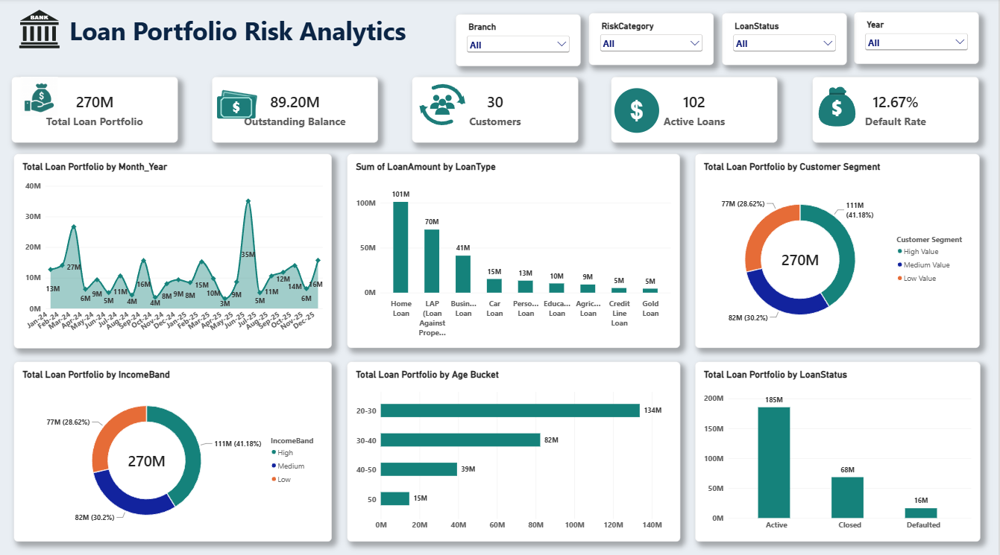
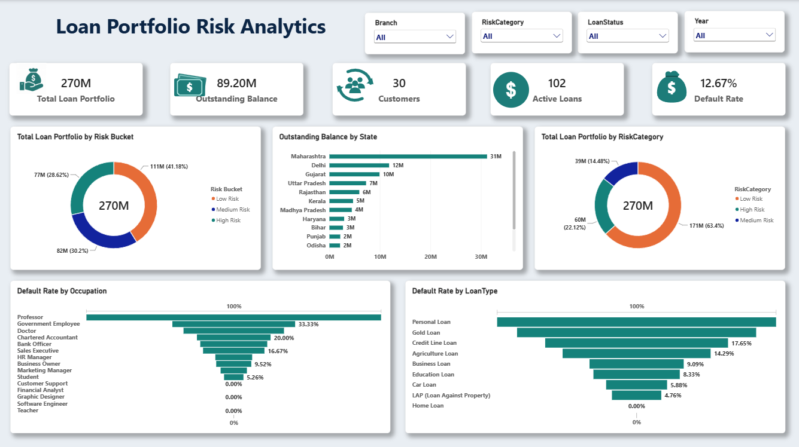

# 🏦 Loan Portfolio Risk Analytics Dashboard

**Power BI | DAX | Power Query | Star Schema | BFSI**

An interactive Power BI dashboard that analyzes a **₹270M loan portfolio** to show where lending volume sits, where defaults come from, and which segments carry the most risk.

---

## 📌 Business Problem

Lending teams need to know **who they lend to, how much, and where defaults are building up**. This dashboard answers:

- How big is the portfolio and how much is still outstanding?
- Which loan types, customer segments and states drive the portfolio?
- Which loan types and occupations show the highest default rates?
- How much exposure sits in High Risk customers?

---

## 📊 Dashboard Preview

### Page 1: Loan Overview

### Page 2: Risk Analysis

---

## 🔑 Key Metrics

- **Total Loan Portfolio:** ₹270M
- **Outstanding Balance:** ₹89.20M
- **Customers:** 30
- **Active Loans:** 102
- **Default Rate:** 12.67%

---

## 🔍 Key Insights

- **High Value customers drive the portfolio**, contributing 41.18% (₹111M) of total lending.
- **Home Loans dominate lending** at ₹101M, followed by LAP at ₹70M, and show a 0% default rate.
- **Personal Loans carry the highest default rate (26.92%)**, followed by Gold Loans (23.08%) and Credit Line Loans (17.65%).
- **High Risk customers represent significant exposure** at 22.12% of the portfolio.
- **A few states account for most of the outstanding balance**, led by Maharashtra (₹31M), Delhi (₹12M) and Gujarat (₹10M).
- **Customers aged 20-30 hold the largest share** of the portfolio (₹134M).

---

## 💡 Recommendations

1. Improve underwriting for Personal Loans.
2. Increase focus on high-credit-score customers.
3. Monitor high-risk customer segments.
4. Diversify the loan portfolio.
5. Create targeted products for premium customers.

---

## 🧱 Data Model

Built on a **star schema** with a central loan fact table connected to dimension tables, which keeps the model fast, clean and easy to filter.

---

## 🛠️ Tools & Skills Used

- **Power BI Desktop:** dashboard design and interactivity
- **Power Query:** data cleaning and transformation
- **DAX:** measures for portfolio, outstanding balance, active loans and default rate
- **Star Schema:** data modeling
- **Slicers:** Branch, RiskCategory, LoanStatus, Year

---

## 📁 Repository Contents

- `Loan_Portfolio_Risk_Analytics.pbix` : Power BI dashboard file
- `loan_overview.png` : Page 1 screenshot
- `risk_analysis.png` : Page 2 screenshot
- `README.md` : project documentation

---

## 🚀 How to Use

1. Download the `.pbix` file.
2. Open it in Power BI Desktop.
3. Use the slicers (Branch, RiskCategory, LoanStatus, Year) to explore the data.

---

## 👤 Author

**Aquib Tahil**
BI Analyst | Power BI Developer | PL-300 Certified | 9.5+ Years in BFSI

- LinkedIn: [linkedin.com/in/aquibtahil](https://www.linkedin.com/in/aquibtahil/)
- Email: a.tahil201@gmail.com
- Tableau Public: [View my dashboards](https://public.tableau.com/app/profile/aquib.tahil8642/vizzes)

⭐ If you found this useful, consider giving the repo a star.
